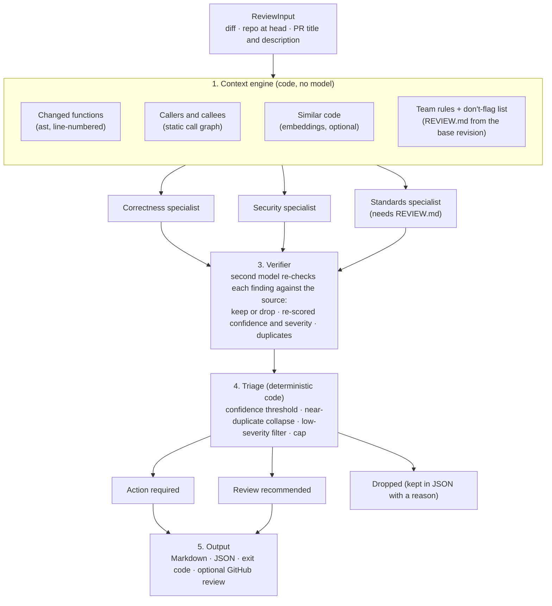

# AI PR Reviewer

A proof of concept for AI code review built as a **pipeline** rather than one big prompt: retrieve context, run three specialist reviewers, have a verifier re-check every finding, then triage deterministically. It is measured against a single-prompt baseline on a labeled set of 16 seeded PRs, with a self-contained HTML scorecard.

- Python 3.10+, managed entirely with [uv](https://docs.astral.sh/uv/). Few dependencies, no vector database, no framework.
- Works from the command line (review a branch before you open a PR) and as a GitHub Action (posts one review with inline comments).
- The model layer is provider-neutral. Pointing it at another OpenAI-compatible gateway is a config change.

Terms follow [GLOSSARY.md](GLOSSARY.md). Every design choice, with its reason, is in [DECISIONS.md](DECISIONS.md); the original build spec is [docs/plan.md](docs/plan.md) (where the two disagree, DECISIONS.md wins).

## How it works



1. **Context engine.** Splits the repo into functions and classes with `ast`, finds the ones the diff touches (including deletions), and adds their callers and callees from a name-based call graph, optionally the most similar other code by embedding, and the team rules. Ground-truth labels never reach the reviewer, and nothing is hand-written per PR.
2. **Specialists.** Correctness, security and standards run in parallel, each with its own prompt and its own "do not flag" list. Standards only checks the numbered rules in `REVIEW.md`, and is skipped when there are none.
3. **Verifier.** A different, stronger model sees each finding, a window of the real source and the same context, and decides keep or drop. This is the precision stage.
4. **Triage.** Plain code: confidence threshold, near-duplicate collapse, tiers (`action required` / `review recommended` / `dropped`) and a cap on findings.
5. **Output.** Markdown or JSON, a stats footer (time, tokens and cost per stage), an exit code (`--fail-on action_required`), and with `--pr --post` one `COMMENT` review on GitHub. It never requests changes and never approves.

## Quickstart

You need [uv](https://docs.astral.sh/uv/getting-started/installation/), git and bash. Python is installed by uv if missing.

```bash
git clone https://github.com/ckcabang/ai-pr-reviewer.git
cd ai-pr-reviewer
uv sync
uv run pytest                       # offline, about a minute (405 tests; the dataset checks are most of it)
export OPENAI_API_KEY=sk-...        # or put it in .env (gitignored) and use: uv run --env-file .env <command>
```

**See the context a review would use (no API key, no cost).** `scripts/demo.sh` builds a throwaway git repo from a dataset PR; use it to make a repo to point the commands at:

```bash
uv run python -m evals.dataset materialize pr09 /tmp/pr09-repo
uv run reviewer context --repo /tmp/pr09-repo --base main
```

**Review a dataset PR (real API calls, about $0.04).**

```bash
scripts/demo.sh pr09 --no-cache     # cross-file bug: pricing.py now returns cents, invoices.py still assumes dollars
scripts/demo.sh pr06                # a clean refactor: should say "No findings"
```

`scripts/demo.sh PR [review args]` materializes the dataset PR into a temporary repo and runs `reviewer review` on it with the PR's own title and description. Drop `--no-cache` to use the disk cache (`.cache/`, gitignored): the first run still calls the API, repeats are instant and marked `(cached)`. The API key is only read when a call misses the cache, so a fully cached replay works with `OPENAI_API_KEY` unset; a cache miss without a key stops with `error: API key not set: ...` (exit 2).

**Review your own branch.**

```bash
uv run reviewer review --repo ~/code/some-service --base origin/main
uv run reviewer review --repo ~/code/some-service --base origin/main \
    --title "Add refunds" --description-file pr.md --format both --out review --fail-on action_required
```

`--repo` is any git repository (the reviewer always runs from this project's environment). `--format md|json|both`, `--out PATH`, `--no-cache`, `--verbose`, `--config FILE` and `--rules FILE` are the other options. Exit codes: 0 normally, 1 for `--fail-on action_required` with action-required findings, 2 on errors. Team rules are read from `REVIEW.md` at the base revision (so a PR cannot edit the rules it is judged by); see [demo_service/REVIEW.md](demo_service/REVIEW.md) for the format.

**Run the evaluation and rebuild the scorecard.**

```bash
uv run python -m evals.run_eval --arms baseline,pipeline,pipeline_no_verifier,pipeline_no_context \
    --runs 3 --out evals/out/mine            # real API calls: about $5 and 12 minutes
uv run python -m evals.scorecard --from evals/out/mine   # offline; writes evals/out/mine/scorecard.html
```

The eval always bypasses the cache (repeat runs would mean nothing). `--prs pr09,pr06` and `--runs 1` make a cheap trial. `evals/out/` is gitignored; the run behind the numbers below is committed in [`evals/results/final/`](evals/results/final/), and you can rebuild its page without any API key:

```bash
uv run python -m evals.scorecard --from evals/results/final
```

**Review a GitHub PR from the command line.**

```bash
export GITHUB_TOKEN=...             # read the PR, and post if --post
uv run reviewer review --repo . --pr https://github.com/OWNER/REPO/pull/N [--post]
```

## Results

The scorecard is [`evals/results/final/scorecard.html`](evals/results/final/scorecard.html) (self-contained HTML: download it or open it from a clone; GitHub shows it as source). Raw data: [`results.json`](evals/results/final/results.json).

Setup: 16 seeded PRs against a FastAPI demo service, 22 planted issues (3 PRs are clean), 3 runs per arm, cache off. Specialists and baseline `gpt-6.1-terra`, verifier `gpt-6.1-sol`, judge `gpt-4.1` (a different generation, D8). Judge agreement check 6/6, 0 review errors, 0 degraded reviews. Cost of the whole run: $4.87.

| | Precision | Recall | F1 | Findings/PR | Cost/PR | Latency p50 / p95 | Clean PRs: any finding / action-required |
|---|---|---|---|---|---|---|---|
| baseline (one diff-only prompt) | 0.66 ± 0.01 | 0.82 ± 0.00 | 0.73 ± 0.01 | 1.71 | $0.0053 | 8.4 s / 16.3 s | 33% / 22% |
| **pipeline** | 0.57 ± 0.01 | **0.94 ± 0.03** | 0.71 ± 0.01 | 2.25 | $0.0429 | 20.5 s / 33.6 s | 33% / **0%** |
| pipeline without verifier | 0.40 ± 0.01 | 0.97 ± 0.03 | 0.56 ± 0.01 | 3.35 | $0.0266 | 12.3 s / 21.6 s | 44% / 0% |
| pipeline without context (diff only) | 0.73 ± 0.05 | 0.79 ± 0.07 | 0.76 ± 0.06 | 1.48 | $0.0167 | 18.6 s / 25.8 s | 0% / 0% |

(mean ± sample std over 3 runs, pooled over PRs within a run. The std is run-to-run model variance only; it does not cover which 22 issues we planted.)

Recall by the context an issue needs (diff only 15 issues, team rules 4, cross-file 3):

| | diff | rules | cross-file |
|---|---|---|---|
| baseline | 80% | 100% | 67% |
| pipeline | 91% | 100% | 100% |
| pipeline without context | 78% | 92% | 67% |

**What the pipeline wins**
- **Recall, especially what needs more than the diff.** 0.94 vs 0.82 overall; the cross-file bug (pr09, cents vs dollars, caught by the pipeline in 3 of 3 runs) is missed by the baseline in all 3 runs. Correctness recall 90% vs 60%.
- **A quiet clean PR at the top tier.** Neither arm is perfectly quiet on clean PRs (both flag a test-isolation point on pr16). But the baseline raised an action-required finding on a clean PR in 2 of 9 runs; the pipeline in none.
- **The verifier is what makes it usable.** Without it the action-required tier is 49% precise (49 true, 52 false); with it, 89% (48 true, 6 false). It costs about 2 matched issues of recall.

**What the pipeline loses**
- **Precision: 0.57 vs 0.66.** More findings per PR (2.25 vs 1.71), and the lower `review recommended` tier is only about 26% precise for both arms. The action-required tier is 89% precise for both.
- **Cost and latency: about 8x the cost per PR ($0.043 vs $0.005) and 2.4x the p50 latency.**
- **F1 is a tie.** 0.71 vs 0.73 is inside the noise. Read the result as "12 points more recall for 9 points less precision, at 8x the price", not as "the pipeline is better".
- **Context is a mixed bag on this dataset.** Removing it gives the best F1 (0.76 ± 0.06, again within noise) at 39% of the cost, but loses exactly the cross-file catch and the correctness recall (0.79 recall, cross-file 67%). Whether the trade is worth it is a product call this eval does not settle.

Two general fixes were made after a first full eval and before this one (D46, D47: near-duplicate collapse needs the same problem, team rules do not apply to test code). The effect is described in DECISIONS.md.

## Live GitHub demo

The composite action ran on two PRs in a demo repo seeded from the dataset (no labels pushed): [ckcabang/ai-review-demo#1](https://github.com/ckcabang/ai-review-demo/pull/1) (pr09: one inline finding at `pricing.py:54`, 1 action required, $0.042) and [#2](https://github.com/ckcabang/ai-review-demo/pull/2) (pr06, a clean refactor: "No findings", $0.026). **The repo is private**, so those links only work if you are signed in with access; the review text is what `reviewer review --pr ... --post` produces.

## Adopt it in a GitHub repo

Copy [`examples/ai-review.yml`](examples/ai-review.yml) to `.github/workflows/ai-review.yml` and add an `OPENAI_API_KEY` repository secret:

```yaml
on:
  pull_request:
    types: [opened, synchronize, ready_for_review]
permissions: {contents: read, pull-requests: write}
jobs:
  review:
    if: github.event.pull_request.draft == false
    runs-on: ubuntu-latest
    steps:
      - uses: actions/checkout@v4
        with: {ref: "${{ github.event.pull_request.head.sha }}", fetch-depth: 0}
      - uses: ckcabang/ai-pr-reviewer@main
        with: {openai-api-key: "${{ secrets.OPENAI_API_KEY }}"}
```

Inputs: `openai-api-key` (required), `github-token` (defaults to the workflow token), `config` (path to a reviewer config in the reviewed repo; default is this repo's `config.yaml`), `fail-on` (`never` by default, so the check always passes). Put a `REVIEW.md` at the root of the reviewed repo for team rules. It never uses `pull_request_target`, and PR text reaches the code only through the GitHub API, not a shell. Fork PRs get a read-only token and will fail to post. Every run is uncached and costs real money (about $0.04 for a small PR).

## Work-laptop setup

Everything is in `config.yaml`; the only environment input is the API key. The work laptop should run a copy of this repo with the work settings committed there.

1. `git clone` and `uv sync`. If PyPI is blocked, set `UV_INDEX_URL=<corporate mirror>`; if the mirror has a corporate TLS certificate, set `UV_NATIVE_TLS=1` or `SSL_CERT_FILE=<ca bundle>`.
2. In `config.yaml` set `llm.base_url` to the internal gateway, `llm.api_key_env` to the variable holding the key, and `models.specialist`, `models.verifier`, `models.baseline` (keep it equal to the specialist for a fair comparison), `models.judge` (eval only) and `models.embedding`. Add each model to `pricing_per_1m_tokens` so cost estimates work. Models that reject `temperature` are handled automatically.
3. TLS errors: set `llm.ca_bundle` to the corporate CA bundle path.
4. No embeddings endpoint: set `context.semantic.enabled: false` (no embedding call is made; a failing call is otherwise logged and skipped).
5. No JSON mode: set `llm.json_mode: false`. The prompts already ask for JSON and a repair retry handles stray text.
6. Not OpenAI-compatible: add an adapter. Implement the `Provider` protocol from `src/reviewer/llm.py` (`chat_json(*, role, model, system, user, temperature) -> (dict, Usage)` and `embed(*, model, texts)`), as `OpenAIProvider` does in `src/reviewer/openai_provider.py`, and return it from `build_provider` in `llm.py`. Nothing else changes; tests use a `FakeProvider` through the same protocol.
7. Check it works on real code: `uv run reviewer review --repo <team repo> --base origin/main`. Add a `REVIEW.md` there to turn on the standards specialist.
8. Is code allowed to leave the building to the model API from CI, or only from developer machines? Are Actions enabled, and are the runners self-hosted and able to reach the gateway? Decide before adopting the action.

## Limitations

- **Synthetic data, one repo.** The 22 issues were planted by us in a service we also wrote; the issue types resemble the specialists' checklists. The baseline is given the same checklist (D6) so the gap comes from structure, but results on real PRs may differ.
- **Small sample.** 16 PRs, 22 issues, 3 runs. Differences of about 0.03 in F1 or recall are noise. The three cross-file issues are too few for more than "caught vs missed".
- **Precision is measured against planted issues only.** Some counted false positives are defensible findings the labels do not list.
- **Same vendor for judge and reviewers**, though a different model generation (D8). Judge agreement was checked on 6 hand-labeled cases.
- **Sampling is not controllable.** The specialist and verifier models reject `temperature` (D21), so two uncached runs differ; only the cache makes the demo deterministic.
- **Confidence is not calibrated.** All 46 pipeline false positives had confidence of at least 0.85, so a threshold cannot remove them.
- **The call graph is name-based** (D35): it misses dynamic dispatch, aliased imports and framework-called routes, and the cross-file catch depends on it.
- **Python only**, and no re-review of new pushes, no feedback buttons, no Jira context, no comparison with Copilot (the v2 plan in docs/plan.md §12).
- **Persistent misses:** the pipeline misses one planted issue (pr03-2, a discount that is not clamped) in every run, as does the baseline. One security issue (pr10) was dropped in one run by the low-severity rule.
- **Not tested on real GitHub beyond the two demo PRs;** fork PRs are not handled.
- The cost figures leave out embedding calls (about $0.02 per million tokens, negligible).

## Repository layout

| Path | What |
|---|---|
| `src/reviewer/` | The engine: `pipeline.py`, `context/`, `agents/`, `verifier.py`, `triage.py`, `render.py`, `github.py`, `llm.py`, `cli.py` |
| `config.yaml` | Models, pricing, context and pipeline settings |
| `demo_service/` | The seeded FastAPI "orders and payments" service, with its `REVIEW.md` rules |
| `evals/` | Dataset (`dataset/prs/`), judge, metrics, arms, `run_eval`, `scorecard`, demo-repo seeding |
| `evals/results/final/` | Committed results and scorecard behind the numbers above |
| `action.yml`, `examples/` | The composite GitHub Action and an adopter workflow |
| `scripts/demo.sh` | One-line demo of a dataset PR |
| `tests/` | Offline tests (a fake provider, mock GitHub transport, real temp git repos) |

## Live demo script (5 to 7 minutes)

1. The problem: generic, noisy AI review gets ignored. Big teams use pipelines, not prompts (Uber, Cloudflare, Atlassian).
2. The diagram above, in one minute.
3. `scripts/demo.sh pr09`: the cross-file catch, with evidence and triage. Then `scripts/demo.sh pr06`: a clean PR, and it stays quiet. Both replay from the cache once it is filled; each stage line says `(cached)`, and `--no-cache` runs them for real (about 20 s and 3 s).
4. The scorecard: the table above, and where it loses.
5. The live PRs in the demo repo, then the roadmap (v2: the team's real PRs, head to head against Copilot).
